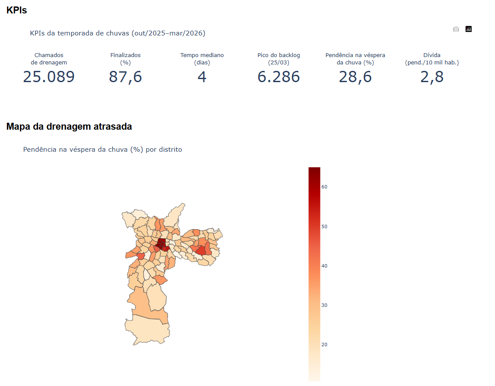
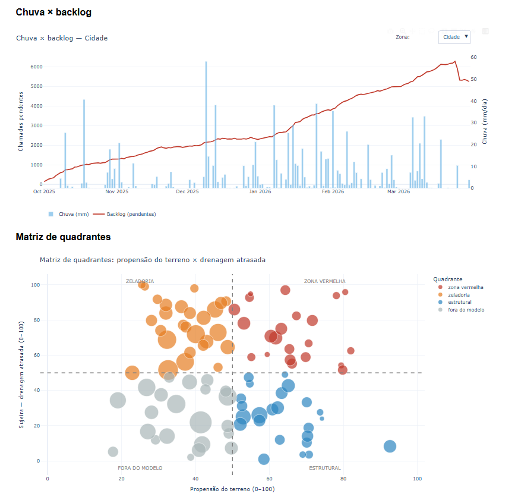
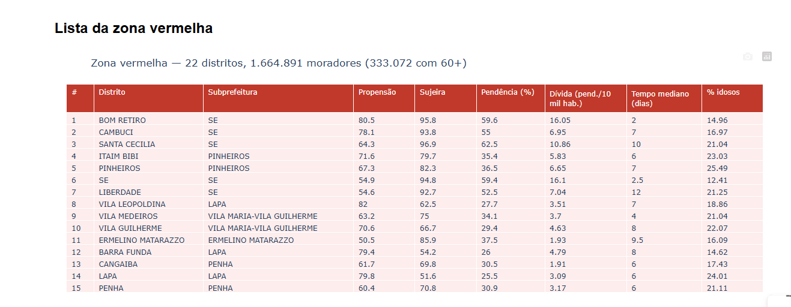
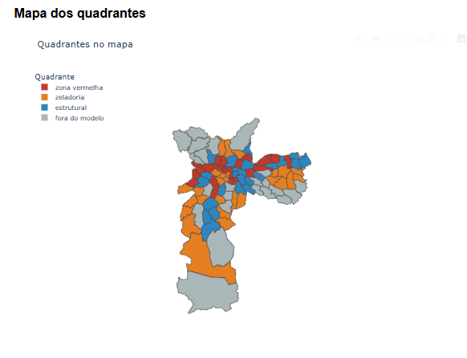
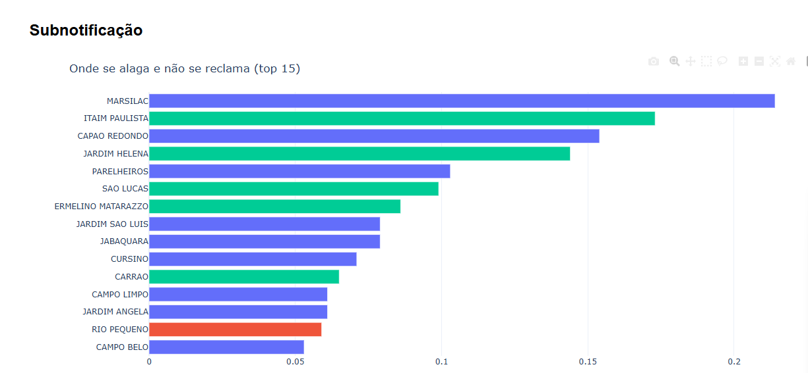
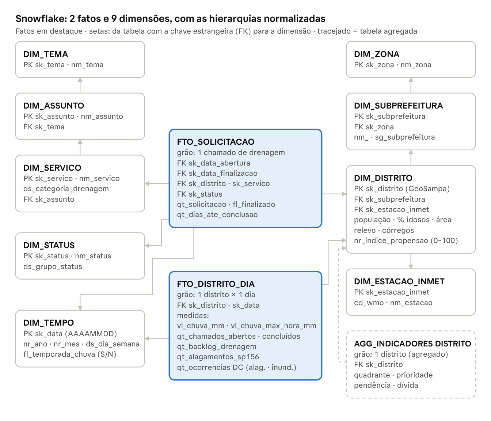
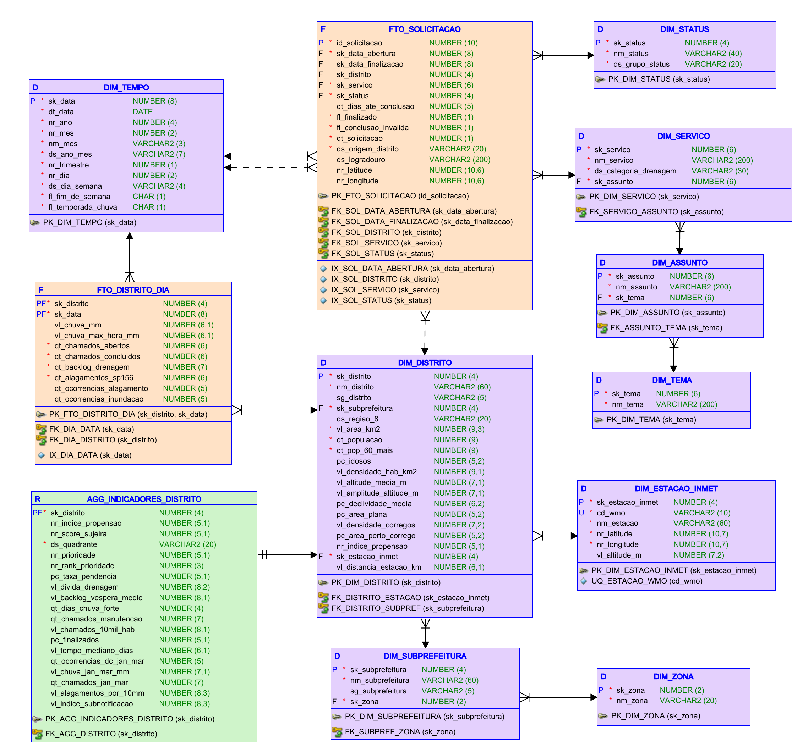

# Rua Avisada — a última milha do alerta de chuva em São Paulo

Data warehouse e painel que cruzam **25 mil chamados de drenagem do SP156**, chuva do INMET, relevo, córregos e Censo 2022 para mostrar, nos 96 distritos de São Paulo, **onde o terreno favorece alagamento e a limpeza de bueiros chega atrasada à chuva**.

Projeto da Global Solution 2026.2 (FIAP · Tecnólogo em Data Science), grupo **Welcome to the DataFrame**. Temporada analisada: chuvas de out/2025 a mar/2026, com dados reais e públicos.

**[Abrir o painel interativo](https://SEU-USUARIO.github.io/rua-avisada/dashboard/painel_rua_avisada.html)** · **[Documento do DW (PDF)](docs/GS_2TSCOR_DW_RuaAvisada_WelcomeToTheDataFrame.pdf)**



## O problema

O alerta da Defesa Civil avisa a cidade inteira, mas o alagamento acontece na rua. O alerta não diz em quais ruas a drenagem está atrasada nem quem mora lá. Ao mesmo tempo, pedidos de limpeza de bueiros, galerias e córregos seguem pendentes quando a chuva chega.

O DW responde três perguntas:

1. Quais distritos são propensos a alagar **e** estão com a drenagem atrasada?
2. O atendimento chega antes da chuva?
3. Onde se alaga e não se reclama?

## Principais achados

| Indicador | Valor na temporada |
|---|---|
| Chamados de manutenção de drenagem (sem cancelados) | 25.089 |
| Finalizados · tempo mediano de atendimento | 87,6% · 4 dias |
| Pedidos pendentes no pico do backlog | 6.286 (25/03/2026) |
| Pendentes na véspera de cada chuva forte (≥ 20 mm), média dos distritos | 28,6% |
| Zona vermelha (terreno propenso + drenagem atrasada) | 22 distritos · 1,66 milhão de moradores · 333 mil com 60+ |

- **A dívida só cresce.** O backlog sobe depois de cada chuva forte e quase não desce: o atendimento corre atrás da chuva.
- **O Centro atende rápido o que atende, mas deixa muito sem resposta.** Bom Retiro, Sé e Santa Cecília têm cerca de 60% dos pedidos pendentes na véspera da chuva.
- **Onde se alaga e não se reclama é a periferia.** Marsilac, Itaim Paulista e Capão Redondo lideram o índice de subnotificação (ocorrências da Defesa Civil por chamado de drenagem).
- **Terreno e atraso não explicam onde a Defesa Civil registrou ocorrências** (correlação de Spearman ≈ 0); elas acompanham a densidade de moradores (+0,36). Por isso o aviso por rua importa tanto quanto a limpeza.

## Painel

Notebook Python (plotly) exportado em HTML interativo, que abre offline, em 3 páginas: visão geral, prevenção e subnotificação.

| Chuva × backlog e matriz de quadrantes | Zona vermelha priorizada |
|---|---|
|  |  |
| **Mapa dos quadrantes** | **Subnotificação** |
|  |  |

## Modelo de dados

Modelo **Snowflake** com 2 fatos, 9 dimensões normalizadas e 1 tabela agregada, entregue em CSV (`data/modelo/`). O modelo físico também foi gerado como DDL Oracle (`sql/`), com PK, FK, IDENTITY e comentários em todas as tabelas e colunas, e desenhado no Oracle SQL Developer Data Modeler.

- `FTO_SOLICITACAO`: 1 linha por chamado de drenagem (25.647 linhas)
- `FTO_DISTRITO_DIA`: 1 linha por distrito por dia (96 × 182 = 17.472 linhas), com chuva, chamados abertos e concluídos, backlog e ocorrências
- Hierarquias: serviço → assunto → tema · distrito → subprefeitura → zona · distrito → estação do INMET



<details>
<summary>Modelo relacional no Oracle Data Modeler</summary>



</details>

## Fontes dos dados

| Fonte | O que usamos |
|---|---|
| [SP156 — Portal de Dados Abertos da Prefeitura](https://dados.prefeitura.sp.gov.br/dataset/dados-do-sp156) | Chamados do 4º TRI 2025 e 1º TRI 2026 |
| [GeoSampa](https://novogeosampa.prefeitura.sp.gov.br/) | Distritos, subprefeituras, Rede de Drenagem e ocorrências de alagamento e inundação da Defesa Civil |
| [INMET — Dados históricos](https://portal.inmet.gov.br/dadoshistoricos) | Chuva horária das estações A701 (Mirante de Santana) e A771 (Interlagos) |
| [TOPODATA / INPE](https://data.inpe.br/bdc/stac/v1/collections/topodata-1) | Altitude e declividade, 30 m (CC-BY-4.0) |
| [Censo 2022 — IBGE, via TabNet da SMS-SP](https://prefeitura.sp.gov.br/web/saude/w/tabnet/30417) | População por distrito e faixa etária |

O número do imóvel e o CEP dos chamados foram descartados no tratamento (LGPD); os indicadores são por distrito.

## Tecnologias

Python (pandas, geopandas, rasterio, numpy) · plotly e Jupyter · Oracle SQL / SQL Developer Data Modeler · modelagem dimensional (Snowflake)

## Estrutura do repositório

```
├── dashboard/   painel em notebook (.ipynb) e exportado em HTML
├── data/
│   ├── modelo/  o DW em CSV: 2 fatos, 9 dimensões e 1 tabela agregada
│   ├── staging/ arquivos intermediários e relatórios de cada etapa
│   └── raw/     dados brutos menores (os grandes são baixados: ver data/raw/README.md)
├── docs/        documento do DW em PDF e imagens do README
├── scripts/     pipeline em Python, etapas 01 a 07
└── sql/         DDL Oracle e modelo relacional em PDF
```

## Como reproduzir

Para ver o resultado não é preciso rodar nada: os CSVs do modelo e o painel em HTML já estão no repositório.

Para refazer o pipeline:

1. Instale Python 3 com `pandas`, `geopandas`, `rasterio`, `plotly` e `jupyter`.
2. Baixe os arquivos grandes que não estão no repositório (SP156, Rede de Drenagem e TOPODATA), seguindo [`data/raw/README.md`](data/raw/README.md).
3. Na pasta do projeto, rode as etapas em ordem:
   ```
   python scripts/01_validar_sp156.py data/raw/sp156/arquivo-final-4-trim-25.csv data/raw/sp156/arquivo-final-1-trim-26.csv
   python scripts/02_bases_territoriais.py
   python scripts/03_tratar_sp156.py data/raw/sp156/arquivo-final-4-trim-25.csv data/raw/sp156/arquivo-final-1-trim-26.csv
   python scripts/04_dimensoes_territoriais.py
   python scripts/05_indice_propensao.py
   python scripts/06_fato_distrito_dia.py
   python scripts/07_indicadores_quadrantes.py
   ```
4. Abra `dashboard/painel_rua_avisada.ipynb` e use *Run All*; o painel é salvo em `dashboard/painel_rua_avisada.html`.

As etapas 06 e 07 e o painel rodam sem os arquivos grandes, porque os resultados das etapas anteriores já estão em `data/modelo/` e `data/staging/`.

## Limitações

- O backlog começa em zero em 01/10/2025: pedidos anteriores ainda pendentes não estão na base.
- Ocorrências da Defesa Civil só a partir de 2026; são casos atendidos, não todos os alagamentos.
- Duas estações do INMET para a cidade inteira: a chuva de cada distrito é a da estação mais próxima.
- Índice de propensão simplificado, por distrito (não por rua).

## Equipe

Grupo **Welcome to the DataFrame** — FIAP, Global Solution 2026.2, turma 2TSCOR: Bruno Gomide, Leonardo Assunção Loiola Lacerda, Pedro Henrique dos Santos Freixo e Vitor Yamashita Coppe.
